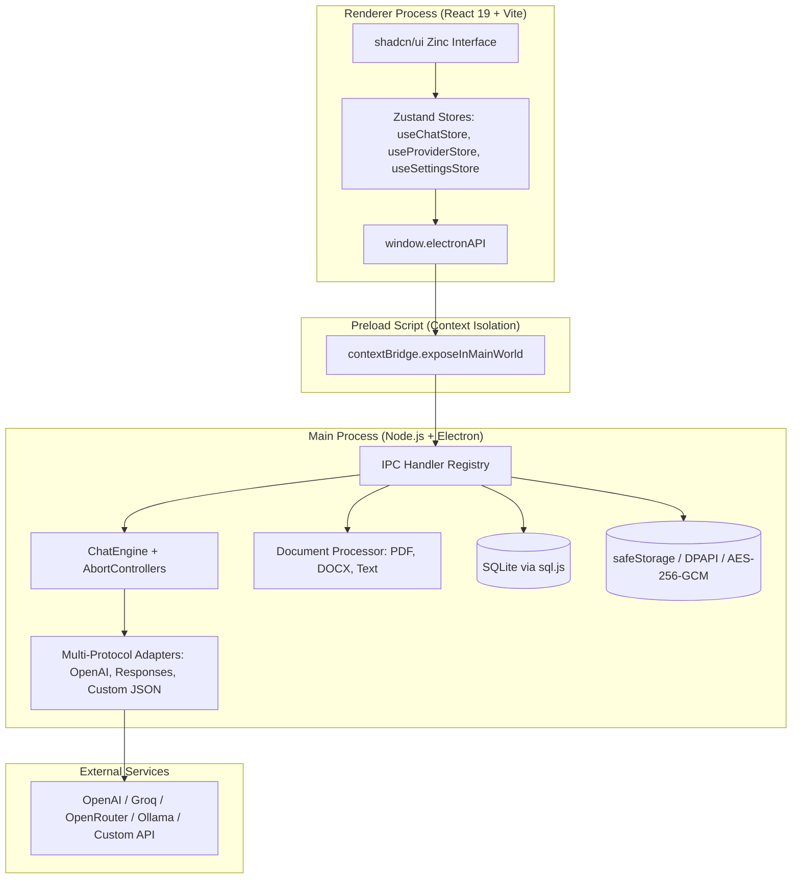

# Universal LLM Desktop Client

An iconic, precision-engineered universal AI desktop client built with **Electron**, **React 19**, **TypeScript**, and **SQLite**. Designed with a surgical **shadcn/ui** zinc monochrome aesthetic grounded in **Apple Human Interface Guidelines (HIG)**, featuring multi-provider adaptation, hardware-backed credential encryption, and instant all-at-once response delivery.

---

## Key Features

- **Universal Multi-Provider Adaptation**: Connect seamlessly to OpenAI, OpenRouter, Anthropic, Groq Cloud, DeepSeek, Ollama, LM Studio, vLLM, or arbitrary custom REST endpoints.
- **Instant All-at-Once Response Delivery**: Displays model outputs cleanly upon completion, bypassing fragile typewriter animations while preserving a sleek "Thinking..." pulse during generation.
- **Reasoning Model Support**: Automatically detects and encapsulates `<think>...</think>` tags (from DeepSeek-R1, Qwen, etc.) in an elegant, collapsible **Thought process** disclosure accordion.
- **shadcn/ui Zinc Monochrome Aesthetic**: Precision 1px borders, deep dark mode surfaces (`#09090B`), subtle elevations, and Geist typography.
- **Hardware-Backed Credential Security**: API keys are securely encrypted using native OS Keychains via Electron `safeStorage` (Windows DPAPI, macOS Keychain, Linux Secret Service), with automatic AES-256-GCM fallback.
- **Local SQLite Persistence**: Thread history, parameters, and settings are stored locally in an embedded SQLite database powered by `sql.js` (WebAssembly).
- **Multimodal Document Processing**: Upload and extract text, tokens, or base64 images from `.pdf`, `.docx`, `.txt`, `.md`, `.json`, and source code files.
- **Rich Markdown & LaTeX**: Full GitHub Flavored Markdown (tables, blockquotes, checklists) and inline/display math formulas rendered with **KaTeX**.
- **Keyboard-First Workflow**: Comprehensive global shortcuts, including **`Ctrl + .`** to immediately enter the prompt composer from anywhere.

---

## Keyboard Shortcuts

| Shortcut | Action | Scope |
|---|---|---|
| **`Ctrl + .`** / **`Cmd + .`** | **Focus Message Composer Input** | Global Window |
| **`Ctrl + N`** / **`Cmd + N`** | **Create New Conversation** | Global Window |
| **`Ctrl + ,`** / **`Cmd + ,`** | **Open Settings Modal** | Global Window |
| **`⌘K`** / **`Ctrl + K`** | **Focus Sidebar Thread Search** | Global Window |
| **`Enter`** | **Submit Message** | Inside Composer |
| **`Shift + Enter`** | **Insert Newline** | Inside Composer |
| **`Escape`** | **Dismiss Modals / Cancel Edit** | Global Window |

---

## Architecture & Process Model

The application strictly adheres to Electron's security model with full context isolation:



---

## Directory & Subsystem Documentation

Every directory in this repository contains dedicated, detailed technical documentation:

| Directory | Documentation Link | Description |
|---|---|---|
| **`scripts/`** | [**`scripts/README.md`**](file:///c:/Users/raghav/Desktop/spare/box/scripts/README.md) | Esbuild and Vite build & development automation scripts. |
| **`tests/`** | [**`tests/README.md`**](file:///c:/Users/raghav/Desktop/spare/box/tests/README.md) | Vitest test suite covering stream parsers, adapters, and validation. |
| **`src/`** | [**`src/README.md`**](file:///c:/Users/raghav/Desktop/spare/box/src/README.md) | High-level architectural overview of the source tree. |
| **`src/shared/`** | [**`src/shared/README.md`**](file:///c:/Users/raghav/Desktop/spare/box/src/shared/README.md) | Shared domain contracts, data types, constants, and schema validation. |
| **`src/preload/`** | [**`src/preload/README.md`**](file:///c:/Users/raghav/Desktop/spare/box/src/preload/README.md) | Secure context bridge exposing `window.electronAPI`. |
| **`src/main/`** | [**`src/main/README.md`**](file:///c:/Users/raghav/Desktop/spare/box/src/main/README.md) | Electron main process entry, window lifecycle, and security headers. |
| **`src/main/documents/`** | [**`src/main/documents/README.md`**](file:///c:/Users/raghav/Desktop/spare/box/src/main/documents/README.md) | Document parsing and token chunking (PDF, DOCX, TXT, MD). |
| **`src/main/engine/`** | [**`src/main/engine/README.md`**](file:///c:/Users/raghav/Desktop/spare/box/src/main/engine/README.md) | Chat completion orchestrator, SSE stream parser, and diagnostics logger. |
| **`src/main/ipc/`** | [**`src/main/ipc/README.md`**](file:///c:/Users/raghav/Desktop/spare/box/src/main/ipc/README.md) | Inter-process communication channel definitions and handler mappings. |
| **`src/main/providers/`** | [**`src/main/providers/README.md`**](file:///c:/Users/raghav/Desktop/spare/box/src/main/providers/README.md) | Multi-protocol provider adapters (OpenAI, Responses, Custom JSON). |
| **`src/main/storage/`** | [**`src/main/storage/README.md`**](file:///c:/Users/raghav/Desktop/spare/box/src/main/storage/README.md) | SQLite database management and OS keychain credential encryption. |
| **`src/renderer/`** | [**`src/renderer/README.md`**](file:///c:/Users/raghav/Desktop/spare/box/src/renderer/README.md) | Vite frontend entrypoint and index HTML configuration. |
| **`src/renderer/src/`** | [**`src/renderer/src/README.md`**](file:///c:/Users/raghav/Desktop/spare/box/src/renderer/src/README.md) | React 19 root component, design system tokens, and global listeners. |
| **`src/renderer/src/components/`** | [**`src/renderer/src/components/README.md`**](file:///c:/Users/raghav/Desktop/spare/box/src/renderer/src/components/README.md) | UI components domain overview. |
| **`src/renderer/src/components/chat/`** | [**`src/renderer/src/components/chat/README.md`**](file:///c:/Users/raghav/Desktop/spare/box/src/renderer/src/components/chat/README.md) | Chat area, message items, composer, markdown, codeblocks, welcome screen. |
| **`src/renderer/src/components/layout/`** | [**`src/renderer/src/components/layout/README.md`**](file:///c:/Users/raghav/Desktop/spare/box/src/renderer/src/components/layout/README.md) | Window titlebar and conversation navigation sidebar. |
| **`src/renderer/src/components/settings/`** | [**`src/renderer/src/components/settings/README.md`**](file:///c:/Users/raghav/Desktop/spare/box/src/renderer/src/components/settings/README.md) | Settings modal and dynamic provider configuration forms. |
| **`src/renderer/src/store/`** | [**`src/renderer/src/store/README.md`**](file:///c:/Users/raghav/Desktop/spare/box/src/renderer/src/store/README.md) | Zustand state stores (`useChatStore`, `useProviderStore`, `useSettingsStore`). |

---

## Quick Start

### 1. Prerequisites
- **Node.js**: v20.0.0 or higher
- **npm**: v9.0.0 or higher

### 2. Installation
```bash
# Clone the repository
git clone <repository-url>
cd box

# Install dependencies
npm install
```

### 3. Development Mode
Starts Vite's hot-reloading dev server and launches the Electron application with main-process auto-restart on file change:
```bash
npm run dev
```

### 4. Running Unit Tests
Runs the complete Vitest test suite validating stream parsers, adapters, document chunkers, and schemas:
```bash
npm test
```

### 5. Production Build
Compiles the Vite frontend bundle and uses `esbuild` to assemble `dist/main` and `dist/preload`:
```bash
npm run build
```

### 6. Packaging Executables
Creates standalone installers (e.g. Windows `.exe`, macOS `.dmg`, Linux `.AppImage`):
```bash
npm run dist
```

---

## Technology Stack

| Domain | Technology | Description |
|---|---|---|
| **Runtime** | [Electron 34](https://www.electronjs.org/) | Cross-platform desktop shell with Chromium & Node.js |
| **Frontend** | [React 19](https://react.dev/) | Modern reactive user interface library |
| **Build Tooling** | [Vite 6](https://vitejs.dev/) + [esbuild](https://esbuild.github.io/) | Lightning-fast HMR and dual-process bundling |
| **Styling** | [Tailwind CSS 3](https://tailwindcss.com/) | Semantic HSL design tokens matching shadcn/ui zinc |
| **State Management**| [Zustand](https://github.com/pmndrs/zustand) | Minimalist, unopinionated reactive client stores |
| **Database** | [sql.js](https://sql.js.org/) | In-process WebAssembly SQLite engine |
| **Security** | `safeStorage` (Electron) | Hardware-backed DPAPI / Keychain credential encryption |
| **Markdown & Math** | `react-markdown` + `KaTeX` | LaTeX equations, tables, and syntax-highlighted code |
| **Testing** | [Vitest](https://vitest.dev/) | Unit & integration test runner |

---

## License

This project is licensed under the [MIT License](file:///c:/Users/raghav/Desktop/spare/box/package.json).
