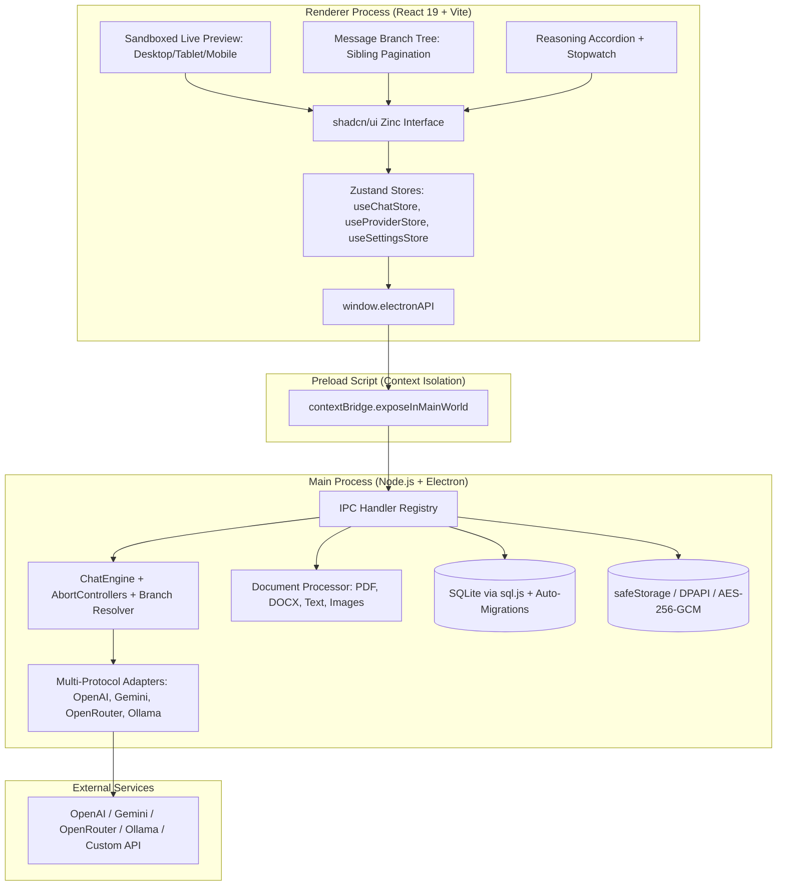

# Universal LLM Desktop Client

An iconic, precision-engineered universal AI desktop client built with **Electron**, **React 19**, **TypeScript**, and **SQLite**. Designed with a surgical **shadcn/ui** zinc monochrome aesthetic grounded in **Apple Human Interface Guidelines (HIG)**, featuring multi-provider adaptation, hardware-backed credential encryption, live reasoning accordions, message branching trees, and sandboxed live code artifact previews.

---

## Key Features

### 1. Universal Multi-Provider Engine
- **Pre-Configured & Custom Providers**: First-class integration with **OpenAI**, **Google Gemini** (`generativelanguage.googleapis.com`), **OpenRouter**, and **Ollama**, plus custom REST/OpenAI-compatible endpoints.
- **Dynamic Model Catalog & Limits Resolution**: Automatically queries provider catalogs to resolve accurate context lengths and output token maximums (e.g. 1M+ for Gemini, 128k for GPT-4o, 64k for Claude/DeepSeek).
- **Adaptive Token Slider**: Token bounds dynamically adjust to the selected model's true limits, featuring compact formatting (`128K`, `8.2K`), quick-stop jump buttons, and automated safety clamping.
- **OpenRouter Fallback Handling**: Automatic model array cap enforcement (3-model ceiling) and robust retry logic with secrets-redacted diagnostics.

### 2. Live Collapsible Reasoning Accordion
- **Multi-Protocol Reasoning Extraction**: Seamlessly captures reasoning from both explicit SSE payload fields (`reasoning_content`) and inline `<think>...</think>` tags (DeepSeek-R1, Qwen 2.5, etc.).
- **Live Stopwatch**: Real-time timer counts reasoning duration during generation and displays the final elapsed duration (e.g., `Thought for 4.5s`).
- **Smooth Auto-Collapse**: Automatically tucks reasoning away into a sleek disclosure accordion once generation finishes, keeping answers readable while remaining 1-click inspectable.
- **SQLite Persistence**: Stores reasoning content and duration (`thinking_duration_ms`) directly with message records.

### 3. Message Branching & Sibling Tree Navigation
- **In-Place Message Editing**: Edit any historical prompt to instantly branch the conversation without losing previous responses.
- **Sibling Pagination (`< 1 / 2 >`)**: Seamlessly cycle through alternative response versions or edited prompts with smooth animation.
- **Branch History Isolation**: Context reconstruction (`ChatEngine.resolveBranchHistory`) follows parent pointer chains back to the root, ensuring the model only sees the active branch path.
- **Regenerate Alternative Answers**: Regenerate assistant turns to create sibling choices at any branch node.

### 4. Sandboxed Code & HTML Live Artifacts Preview
- **Dual-Tab Interface**: Code blocks containing HTML, SVG, or interactive web markup feature a dual **`[Preview]`** and **`[Code]`** header toggle.
- **Secure Sandboxed Isolation**: Runs inside an isolated `iframe` with `sandbox="allow-scripts"` and strictly **omits** `allow-same-origin`. This forces an opaque `null` origin, completely isolating previewed scripts from Electron DOM, `localStorage`, and IPC bridges.
- **Responsive Device Switcher**: Inspect layouts in **Desktop** (`100%`), **Tablet** (`768px`), and **Mobile** (`375px` with simulated hardware notch).
- **Fullscreen Modal View**: Expand artifacts into an immersive fullscreen preview with raw code view, hot re-mount reload, and direct `.html` or `.svg` download.

### 5. Document Extraction & Multimodal Vision
- **Comprehensive Document Extraction**: Upload and extract text, page counts, and estimated tokens from `.pdf`, `.docx`, `.txt`, `.md`, and `.json`.
- **Vision Support**: Drag and drop images with inline preview chips, image modal inspection, and base64 payloads to vision-enabled models.
- **Full Conversation Markdown Export**: Export entire chat sessions (including reasoning summaries and timestamps) with one click.

### 6. Security, Storage & Ergonomics
- **Hardware-Backed Credential Security**: API keys are securely encrypted using native OS Keychains via Electron `safeStorage` (Windows DPAPI, macOS Keychain, Linux Secret Service), with automatic AES-256-GCM fallback.
- **Embedded WebAssembly SQLite**: Thread history, provider credentials, and settings are persisted locally via `sql.js` with safe, non-destructive schema migrations.
- **shadcn/ui Zinc Monochrome Aesthetic**: Precision 1px borders, deep dark mode surfaces (`#09090B`), subtle elevations, and Geist typography.
- **Rich Markdown & LaTeX**: Full GitHub Flavored Markdown (tables, blockquotes, checklists) and inline/display math formulas rendered with **KaTeX**.
- **Keyboard-First Workflow**: Global shortcuts, including **`Ctrl + .`** to immediately jump into the composer from anywhere.

---

## Keyboard Shortcuts

| Shortcut | Action | Scope |
|---|---|---|
| **`Ctrl + .`** / **`Cmd + .`** | **Focus Message Composer Input** | Global Window |
| **`Ctrl + N`** / **`Cmd + N`** | **Create New Conversation** | Global Window |
| **`Ctrl + ,`** / **`Cmd + ,`** | **Open Settings Modal** | Global Window |
| **`⌘K`** / **`Ctrl + K`** | **Focus Sidebar Thread Search** | Global Window |
| **`Enter`** | **Submit Message** | Inside Composer |
| **`Shift + Enter`** | **Insert Newline** | Inside Composer |
| **`Escape`** | **Dismiss Modals / Cancel Edit / Close Fullscreen** | Global Window |

---

## Architecture & Process Model

The application strictly adheres to Electron's security model with context isolation and dedicated process boundaries:



---

## Directory & Subsystem Documentation

Every subsystem in this repository contains dedicated technical documentation:

| Directory | Documentation Link | Description |
|---|---|---|
| **`scripts/`** | [**`scripts/README.md`**](file:///c:/Users/raghav/Desktop/spare/box/scripts/README.md) | Esbuild and Vite build & development automation scripts. |
| **`tests/`** | [**`tests/README.md`**](file:///c:/Users/raghav/Desktop/spare/box/tests/README.md) | Vitest test suite covering stream parsers, adapters, branching, artifacts, and migrations. |
| **`src/`** | [**`src/README.md`**](file:///c:/Users/raghav/Desktop/spare/box/src/README.md) | High-level architectural overview of the source tree. |
| **`src/shared/`** | [**`src/shared/README.md`**](file:///c:/Users/raghav/Desktop/spare/box/src/shared/README.md) | Shared domain contracts, data types, constants, and schema validation. |
| **`src/preload/`** | [**`src/preload/README.md`**](file:///c:/Users/raghav/Desktop/spare/box/src/preload/README.md) | Secure context bridge exposing `window.electronAPI`. |
| **`src/main/`** | [**`src/main/README.md`**](file:///c:/Users/raghav/Desktop/spare/box/src/main/README.md) | Electron main process entry, window lifecycle, and security headers. |
| **`src/main/documents/`** | [**`src/main/documents/README.md`**](file:///c:/Users/raghav/Desktop/spare/box/src/main/documents/README.md) | Document parsing and token chunking (PDF, DOCX, TXT, MD, images). |
| **`src/main/engine/`** | [**`src/main/engine/README.md`**](file:///c:/Users/raghav/Desktop/spare/box/src/main/engine/README.md) | Chat completion orchestrator, branch history resolver, SSE stream parser, and diagnostics. |
| **`src/main/ipc/`** | [**`src/main/ipc/README.md`**](file:///c:/Users/raghav/Desktop/spare/box/src/main/ipc/README.md) | Inter-process communication channel definitions and handler mappings. |
| **`src/main/providers/`** | [**`src/main/providers/README.md`**](file:///c:/Users/raghav/Desktop/spare/box/src/main/providers/README.md) | Multi-protocol provider adapters (OpenAI, Gemini, OpenRouter, Ollama). |
| **`src/main/storage/`** | [**`src/main/storage/README.md`**](file:///c:/Users/raghav/Desktop/spare/box/src/main/storage/README.md) | SQLite database management, safe column migrations, and OS keychain encryption. |
| **`src/renderer/`** | [**`src/renderer/README.md`**](file:///c:/Users/raghav/Desktop/spare/box/src/renderer/README.md) | Vite frontend entrypoint and index HTML configuration. |
| **`src/renderer/src/`** | [**`src/renderer/src/README.md`**](file:///c:/Users/raghav/Desktop/spare/box/src/renderer/src/README.md) | React 19 root component, design system tokens, and global listeners. |
| **`src/renderer/src/components/`** | [**`src/renderer/src/components/README.md`**](file:///c:/Users/raghav/Desktop/spare/box/src/renderer/src/components/README.md) | UI components domain overview. |
| **`src/renderer/src/components/chat/`** | [**`src/renderer/src/components/chat/README.md`**](file:///c:/Users/raghav/Desktop/spare/box/src/renderer/src/components/chat/README.md) | Message items, branching buttons, thinking accordions, code artifacts, and composer. |
| **`src/renderer/src/components/layout/`** | [**`src/renderer/src/components/layout/README.md`**](file:///c:/Users/raghav/Desktop/spare/box/src/renderer/src/components/layout/README.md) | Window titlebar and conversation navigation sidebar. |
| **`src/renderer/src/components/settings/`** | [**`src/renderer/src/components/settings/README.md`**](file:///c:/Users/raghav/Desktop/spare/box/src/renderer/src/components/settings/README.md) | Settings modal and dynamic provider configuration forms. |
| **`src/renderer/src/store/`** | [**`src/renderer/src/store/README.md`**](file:///c:/Users/raghav/Desktop/spare/box/src/renderer/src/store/README.md) | Zustand state stores (`useChatStore`, `useProviderStore`, `useSettingsStore`). |

---

## Quick Start

### 1. Prerequisites
- **Node.js**: v20.0.0 or higher
- **npm**: v9.0.0 or higher

### 2. Installation
```bash
# Clone the repository
git clone <repository-url>
cd box

# Install dependencies
npm install
```

### 3. Development Mode
Starts Vite's hot-reloading dev server and launches the Electron application with main-process auto-restart on file change:
```bash
npm run dev
```

### 4. Running Unit Tests
Runs the complete 56-test Vitest test suite validating stream parsers, adapters, message branching, artifact generation, and SQLite migrations:
```bash
npm test
```

### 5. Production Build
Compiles the Vite frontend bundle and uses `esbuild` to assemble `dist/main` and `dist/preload`:
```bash
npm run build
```

### 6. Packaging Executables
Creates standalone installers (e.g. Windows `.exe`, macOS `.dmg`, Linux `.AppImage`):
```bash
npm run dist
```

---

## Technology Stack

| Domain | Technology | Description |
|---|---|---|
| **Runtime** | [Electron 34](https://www.electronjs.org/) | Cross-platform desktop shell with Chromium & Node.js |
| **Frontend** | [React 19](https://react.dev/) | Modern reactive user interface library |
| **Build Tooling** | [Vite 6](https://vitejs.dev/) + [esbuild](https://esbuild.github.io/) | Lightning-fast HMR and dual-process bundling |
| **Styling** | [Tailwind CSS 3](https://tailwindcss.com/) | Semantic HSL design tokens matching shadcn/ui zinc |
| **State Management**| [Zustand 5](https://github.com/pmndrs/zustand) | Minimalist, unopinionated reactive client stores |
| **Database** | [sql.js](https://sql.js.org/) | In-process WebAssembly SQLite engine with auto-migrations |
| **Security** | `safeStorage` (Electron) | Hardware-backed DPAPI / Keychain credential encryption |
| **Markdown & Math** | `react-markdown` + `KaTeX` | LaTeX equations, tables, and syntax-highlighted code |
| **Sandbox Preview** | Native isolated `<iframe>` | `allow-scripts` without `allow-same-origin` (safe null origin) |
| **Testing** | [Vitest](https://vitest.dev/) | 56 tests across 10 suites validating full client pipeline |

---

## License

This project is licensed under the [MIT License](file:///c:/Users/raghav/Desktop/spare/box/package.json).
