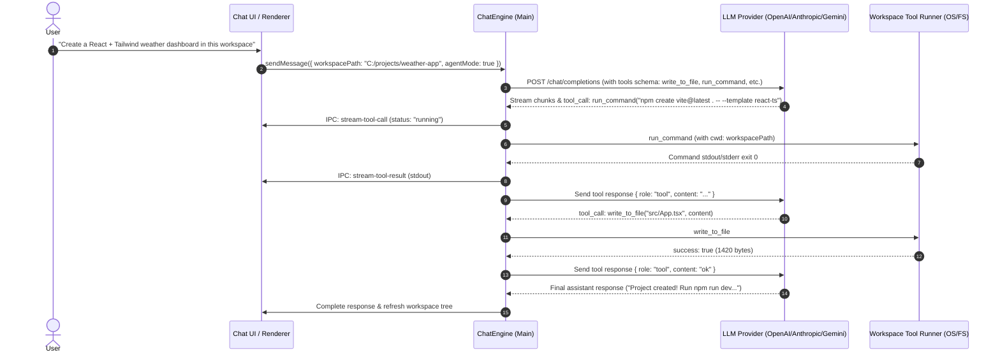

# Implementation Plan: Agentic Workspace & Project Creation Engine

Turn the Universal LLM Client into a full-fledged agentic coding companion capable of creating projects, writing and editing files, running terminal commands, and navigating codebases—modeled after the architecture of **Claude Code**, **OpenAI Codex**, and **Antigravity**.

---

## Goal Description

Currently, our client operates as a conversational and artifact-previewing client: users can prompt models, stream reasoning, manage conversation branches, and preview isolated HTML/SVG artifacts. However, models cannot interact with the user's local filesystem or terminal to create projects, scaffold directories, run builds, or edit multi-file codebases.

This feature introduces an **Agentic Coding Mode**:
1. **Workspace Boundary**: Users select a target workspace directory (e.g., `c:\projects\my-app`) for any conversation.
2. **Tool Execution Engine**: Electron Main process exposes a safe, audited set of coding tools (`write_to_file`, `view_file`, `replace_file_content`, `list_dir`, `run_command`, `grep_search`).
3. **Multi-Turn Agent Loop (ReAct)**: `ChatEngine` handles tool-calling protocols (OpenAI function calling, Anthropic tool use, OpenRouter tools), executes requested tools locally in the workspace, feeds results back to the model, and loops until the project task is complete.
4. **Rich Agent UI & File Explorer**: The chat interface renders real-time tool execution cards (file writes, terminal outputs, file inspection) and a live workspace file tree drawer.



---

## User Review Required

> [!IMPORTANT]
> **Command Execution Safety & Confirmation**: Running terminal commands (`npm`, `git`, `python`, etc.) directly on the user's host operating system is a core feature of Claude Code and Codex, but carries security implications.
> We propose two execution modes configurable in conversation/settings:
> 1. **Auto-approve safe operations** (`write_to_file`, `view_file`, `list_dir` scoped to workspace root).
> 2. **Configurable Command Policy**: An optional "Ask before running commands" toggle or "Auto-run commands in workspace" mode with user-configurable timeout and output truncation guards.

> [!NOTE]
> **Provider Tool Calling Support**:
> - Native tool/function calling is supported by OpenAI (`gpt-4o`, `o3-mini`, `gpt-4.5`), Anthropic (`claude-3-7-sonnet`, `claude-3-5-sonnet`), OpenRouter (models with tool capability), and Gemini.
> - For models without native function calling, we provide an automatic **XML Tool Parsing Fallback** (e.g. `<tool_call name="write_to_file"><path>...</path></tool_call>`), exactly like Claude Code's prompt-based tool execution harness.

---

## Open Questions

> [!IMPORTANT]
> **Q1: Workspace Scope**: Should every conversation have its own distinct workspace folder (e.g. Conversation A is working on `C:/apps/project-one`, Conversation B on `C:/apps/project-two`), or should there be a global active workspace toolbar selector?
> *Recommendation*: Associate the workspace path with the conversation (`conversation.workspacePath`), while allowing a quick "Select Workspace" folder picker button at the top of the chat area.

> [!NOTE]
> **Q2: Agent Turn Depth**: How many autonomous tool execution steps should the agent be allowed to take before stopping or asking for continuation?
> *Recommendation*: Set a sensible default maximum of 15 turns per prompt with a "Continue Agent" button if the model requires additional iterations for massive projects.

---

## Proposed Changes

Grouping changes logically from **Backend (Main process & Tools)** to **Engine (Tool loop)** to **Preload & IPC** to **Frontend (UI & Workspace Tree)**.

---

### Phase 1: Workspace Coding Tools System (Electron Main)

Implement secure local file and command execution tools restricted to the declared workspace directory.

#### [NEW] `src/main/engine/tools/workspace-tools.ts`
- Implements:
  - `write_to_file(workspaceRoot, filePath, content, overwrite)`: Creates/updates files, ensures parent directories exist, validates path stays within `workspaceRoot`.
  - `view_file(workspaceRoot, filePath, startLine?, endLine?)`: Reads file contents with line slicing and truncation safety.
  - `replace_file_content(workspaceRoot, filePath, targetContent, replacementContent)`: Efficient surgical string replacement.
  - `list_dir(workspaceRoot, dirPath?, recursive?, maxDepth?)`: Directory crawler returning tree metadata (files, folders, sizes).
  - `run_command(workspaceRoot, command, timeoutMs?)`: Spawns terminal process with `child_process.spawn`, captures stdout/stderr with real-time streaming, enforces workspace `cwd`.
  - `grep_search(workspaceRoot, query, includePattern?)`: Fast text search across files.
- Path Traversal Guard: Prevents `../..` escapes outside `workspaceRoot`.

#### [NEW] `src/main/engine/tools/tool-definitions.ts`
- Defines the OpenAI / Anthropic function calling schemas for:
  - `write_to_file`
  - `view_file`
  - `replace_file_content`
  - `list_dir`
  - `run_command`
  - `grep_search`
- Includes comprehensive descriptions, parameter validations, and prompt guidelines inspired by Claude Code's system prompts.

---

### Phase 2: Agent Execution Loop in `ChatEngine`

Extend `ChatEngine` from a single-turn stream handler to a full multi-turn ReAct agent loop.

#### [MODIFY] `src/main/engine/chat-engine.ts`
- Add `executeAgentLoop(options: SendMessageOptions)`:
  - Injects coding tools schema into request when `conversation.workspacePath` is configured.
  - While model emits `tool_calls` and steps < `maxTurns`:
    1. Parse tool call name and arguments.
    2. Notify renderer via IPC: `chat:agent-tool-call` (status: `executing`).
    3. Execute the tool on the filesystem or terminal via `WorkspaceTools`.
    4. Notify renderer via IPC: `chat:agent-tool-result` (stdout / status).
    5. Save tool message to SQLite database (`role: 'tool'`, `tool_call_id`).
    6. Re-invoke adapter with updated history including tool output.
  - Handles cancellation/stop gracefully at any tool step.

#### [MODIFY] `src/main/providers/openai-adapter.ts`
- Extend request parameters with optional `tools` array.
- Parse streamed `tool_calls` from OpenAI/OpenRouter SSE chunks (`choice.delta.tool_calls`).
- Emit parsed tool calls to caller.

#### [MODIFY] `src/main/storage/database.ts`
- Update SQLite migrations:
  - Add `workspace_path TEXT` to `conversations` table.
  - Add `tool_calls_json TEXT` and `tool_call_id TEXT` to `messages` table.

---

### Phase 3: IPC & Preload APIs

#### [MODIFY] `src/main/ipc/channels.ts` & `src/main/ipc/handlers.ts`
- Add IPC handlers:
  - `dialog:select-workspace`: Opens native directory picker dialog.
  - `workspace:get-tree`: Fetches file tree for the active workspace.
  - `workspace:open-in-explorer`: Reveals workspace in Windows Explorer / OS Finder.
- Broadcast stream channels:
  - `chat:agent-tool-call`
  - `chat:agent-tool-result`

#### [MODIFY] `src/preload/index.ts`
- Expose workspace selection and tree query methods on `window.electronAPI`.
- Add event listeners for agent tool updates.

---

### Phase 4: UI / Renderer (Agentic Experience & Workspace Drawer)

#### [NEW] `src/renderer/src/components/chat/AgentToolCard.tsx`
- Interactive visual cards rendered inline within the chat stream for each tool execution:
  - **File Write Card**: Displays filename, byte size, diff / preview toggle, and status badge.
  - **Terminal Command Card**: Terminal-like dark container with real-time stdout/stderr streaming, elapsed time counter, and exit code badge.
  - **Directory / File Search Card**: Collapsible list of scanned files.

#### [NEW] `src/renderer/src/components/workspace/WorkspaceDrawer.tsx`
- Collapsible side panel or top bar displaying:
  - Active workspace directory path with "Select Folder" / "Change" button.
  - Live interactive file tree (expandable folders, file icons, clickable to inspect).
  - Quick refresh button and "Open in File Explorer" button.
  - Live indicator when the AI agent is actively modifying files.

#### [MODIFY] `src/renderer/src/components/chat/ChatArea.tsx`
- Add Workspace banner / selector button in the chat header:
  - Shows `📁 Workspace: <folder_name>` or `[+ Set Workspace Directory]`.
  - Toggle button to show/hide the Workspace File Tree Drawer.

#### [MODIFY] `src/renderer/src/store/useChatStore.ts`
- Track active workspace path per conversation.
- Store real-time tool execution states during agent streaming.

---

## Verification Plan

### Automated Tests
1. **Tool Operations Test** (`tests/workspace-tools.test.ts`):
   - Test directory creation, file writing, safe path traversal rejection (`../../`).
   - Test surgical `replace_file_content` accuracy.
   - Test `run_command` output capture and timeout handling.
   - Test directory tree generation.
2. **Agent ReAct Loop Test** (`tests/agent-engine.test.ts`):
   - Mock LLM responses that request `write_to_file` followed by `run_command` followed by final text.
   - Verify tool responses are properly formatted, tool results appended, and final message persisted with full history.
3. **Database Migration Test** (`tests/database-migration.test.ts`):
   - Verify SQLite schema upgrades cleanly for `workspace_path`, `tool_calls_json`, and `tool_call_id`.
4. Run full suite:
   ```powershell
   npm test
   npm run build
   ```

### Manual Verification
1. Open the desktop app (`npx electron .`).
2. Create a new conversation and click **Set Workspace** to point to a test folder (e.g. `C:\Users\raghav\Desktop\test-agent-workspace`).
3. Send prompt:
   > *"Create a new Node.js project with an index.js that logs a greeting and a package.json with an author and test script."*
4. Verify:
   - Tool execution card displays in real-time as `package.json` and `index.js` are written.
   - Real files appear on disk in the chosen workspace folder.
   - Workspace drawer updates to show the generated project files.
   - Assistant completes turn with an accurate project walkthrough.
