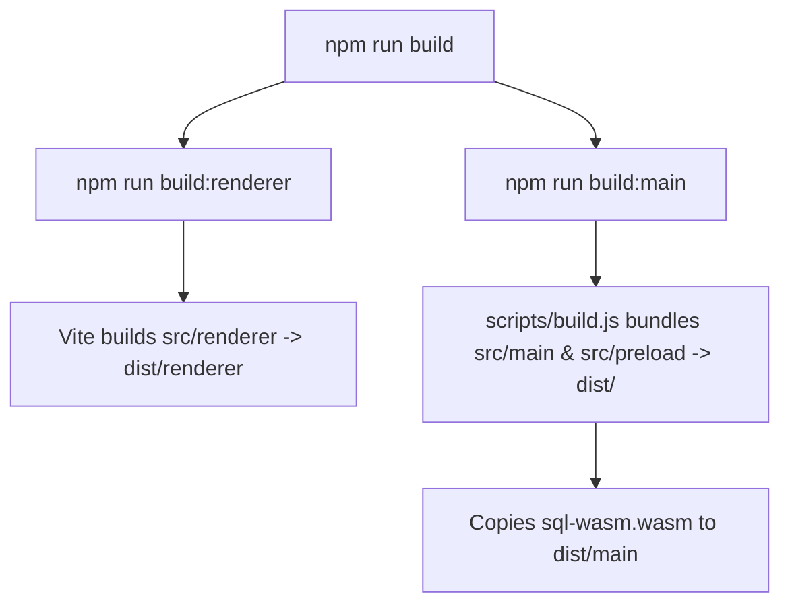

# Build & Development Scripts (`scripts/`)

This directory contains Node.js automation scripts for compiling, bundling, and launching both the main (Electron) and renderer (Vite/React) processes in development and production environments.

---

## Files Overview

### 1. [`build.js`](file:///c:/Users/raghav/Desktop/spare/box/scripts/build.js)
- **Purpose**: Compiles the Electron main process and preload scripts into production-ready JavaScript bundles in `dist/main` and `dist/preload`.
- **Key Actions**:
  - Uses `esbuild` to bundle:
    - Entry: `src/main/index.ts` -> Output: `dist/main/index.js` (Target: Node 20+, Format: CommonJS, Platform: Node).
    - Entry: `src/preload/index.ts` -> Output: `dist/preload/index.js` (Target: Node 20+, Format: CommonJS, Platform: Node).
  - Copies `sql-wasm.wasm` from `node_modules/sql.js/dist/` into `dist/main/` so the WebAssembly SQLite runtime resolves properly at runtime.
  - Marks native Electron modules as external (`electron`, `sql.js`, `better-sqlite3`, etc.).
- **Execution**: Triggered via `npm run build:main` or as part of `npm run build`.

---

### 2. [`dev.js`](file:///c:/Users/raghav/Desktop/spare/box/scripts/dev.js)
- **Purpose**: Orchestrates the local development loop with hot-module replacement (HMR) and automatic Electron lifecycle management.
- **Key Actions**:
  - **Vite Dev Server**: Starts Vite on `http://localhost:5173` serving `src/renderer`.
  - **Esbuild Watcher**: Watches `src/main/**/*.ts`, `src/preload/**/*.ts`, and `src/shared/**/*.ts`, rebuilding `dist/` on code changes.
  - **Electron Spawning**: Boots the Electron process pointing to Vite's dev server (`ELECTRON_DEV=true`).
  - **Hot Restart**: Automatically restarts the Electron main process when main/preload source files change.
  - **Graceful Termination**: Captures `SIGINT` / `SIGTERM` to cleanly terminate Vite and Electron child processes.
- **Execution**: Triggered via `npm run dev`.

---

## Build Pipeline Flow

