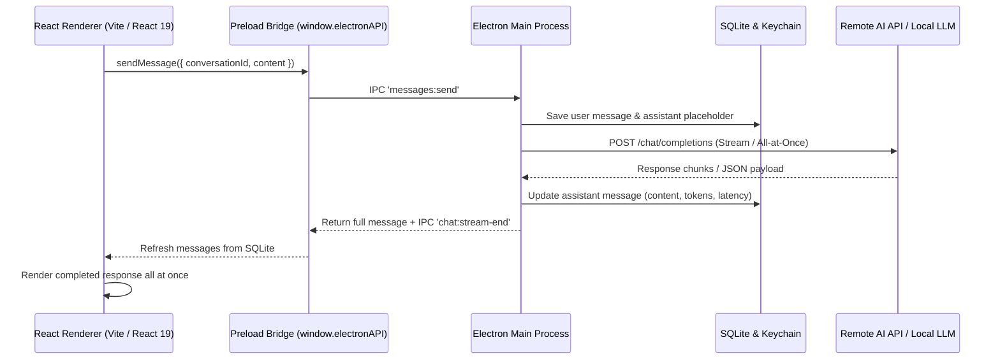

# Application Source Architecture (`src/`)

This directory contains the entire source codebase for the Universal LLM Desktop Client. The application follows a modular, three-tier Electron architecture with strict process isolation and a unified shared contract layer.

---

## Architectural Tiers

```
src/
├── shared/     # Shared domain contracts, types, constants, and validation
├── preload/    # Secure contextBridge exposing window.electronAPI
├── main/       # Node.js Electron main process (OS, SQLite, AI adapters, IPC)
└── renderer/   # React 19 single-page application (shadcn/ui zinc interface)
```

---

## Process Separation & Communication



---

## Subdirectory Documentation

- **[`src/shared/`](file:///c:/Users/raghav/Desktop/spare/box/src/shared/README.md)**: Common TypeScript interfaces, model parameter validations, default provider configurations, web tool schemas, and citation models.
- **[`src/preload/`](file:///c:/Users/raghav/Desktop/spare/box/src/preload/README.md)**: Secure context isolation bridge defining `window.electronAPI`, streaming listeners, and browser search/fetch handlers.
- **[`src/main/`](file:///c:/Users/raghav/Desktop/spare/box/src/main/README.md)**: Electron main process, window creation, SQLite persistence, sandboxed Chromium browser engine ([`src/main/browser/`](file:///c:/Users/raghav/Desktop/spare/box/src/main/browser/README.md)), and AI providers.
- **[`src/renderer/`](file:///c:/Users/raghav/Desktop/spare/box/src/renderer/README.md)**: Vite frontend, React 19 component tree, Zustand stores, slide-over browser drawer, and shadcn/ui zinc styling.
